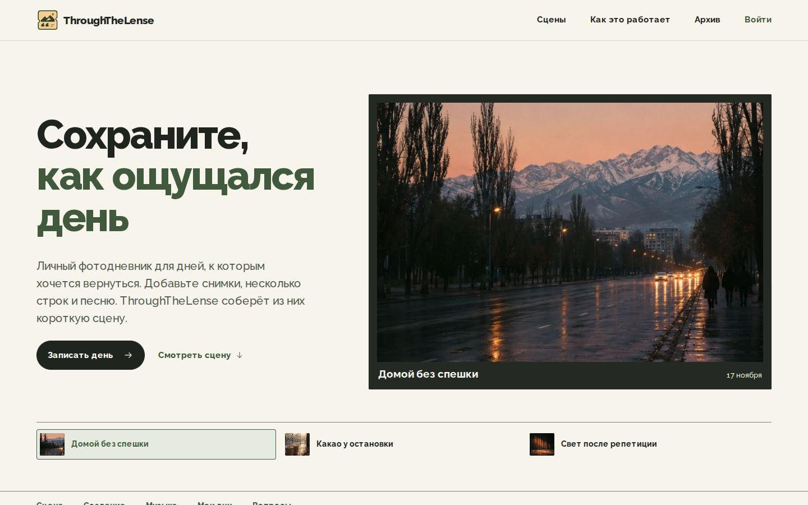

# ThroughTheLense

Личный фотодневник, который сохраняет не событие, а то, как ощущался день. Из снимка, нескольких строк и песни он собирает короткую сцену: сначала кадр, затем на музыкальном акценте появляется дословная фраза автора, и снова возвращается тот же кадр. Проект сделан для Genesis Hackathon, трек ArtTech.

[Открыть прототип](https://throughthelense-production.up.railway.app/) · [Страница для жюри](https://throughthelense-production.up.railway.app/jury.html) · [Редактор с примером](https://throughthelense-production.up.railway.app/journal.html?mode=guest&example=demo-street#new) · [Гостевой архив](https://throughthelense-production.up.railway.app/journal.html?mode=guest#archive)

## Проверка за одну минуту

1. Откройте [«Домой без спешки»](https://throughthelense-production.up.railway.app/journal.html?mode=guest#day/demo-street) и запустите сцену. Посмотрите, как после фразы возвращается первый снимок.
2. В [сравнении песен](https://throughthelense-production.up.railway.app/#experiment) оставьте кадр и фразу прежними. «Вечерний маршрут» раскрывает фразу на **2,7 с**, а «Два стаканчика» — на **4,6 с**.
3. В [редакторе](https://throughthelense-production.up.railway.app/journal.html?mode=guest&example=demo-street#new) возьмите материалы примера, соберите сцену и сохраните день. В меню «Действия» скачайте папку. Для восстановления распакуйте ZIP и откройте `day.json` в гостевом архиве.

| Результат | Что передаёт атмосферу | Папка дня |
| --- | --- | --- |
| [Домой без спешки](https://throughthelense-production.up.railway.app/journal.html?mode=guest#day/demo-street) | Отражение в луже, шум мокрой дороги и второй снимок на фразе | [01-domoy-bez-speshki.zip](https://throughthelense-production.up.railway.app/submission/01-domoy-bez-speshki.zip) |
| [Какао у остановки](https://throughthelense-production.up.railway.app/journal.html?mode=guest#day/demo-cocoa) | Длинная пауза, тёплая обложка и разговор на фоне улицы | [02-kakao-u-ostanovki.zip](https://throughthelense-production.up.railway.app/submission/02-kakao-u-ostanovki.zip) |
| [Свет после репетиции](https://throughthelense-production.up.railway.app/journal.html?mode=guest#day/demo-stage) | Пустая сцена и затихающий фон на словах об аплодисментах | [03-svet-posle-repeticii.zip](https://throughthelense-production.up.railway.app/submission/03-svet-posle-repeticii.zip) |



[Описание проекта](docs/submission/description.md) · [Художественные приёмы](docs/submission/techniques.md) · [Инструменты и источники](docs/submission/tools.md) · [Как проверить результаты](docs/submission/results.md)

## Запуск локально

Нужны Node.js 22 и Go 1.26+. Из корня репозитория:

```sh
npm ci && npm run build && go -C backend run ./cmd/server
```

Откройте <http://127.0.0.1:8080>. Это тот же сервер, что работает на сайте: страницы, аккаунты и дни в SQLite (`backend/data/`).

Без Go подойдёт локальный сервер на Python 3 с тем же API. На Mac можно дважды нажать **Открыть ThroughTheLense.command**.

```sh
npm ci && npm run build:visuals && python3 serve.py
```

Он откроет <http://127.0.0.1:8000>, записи хранятся в `.ttl-data/journal.sqlite`. Без входа дни и черновики остаются в браузере (IndexedDB).

## Что попробовать

1. На главной выберите одно из трёх воспоминаний и нажмите **Смотреть сцену**. В главе **Музыка** сравните, когда появляется одна и та же фраза под три разные песни.
2. Нажмите **Записать день**. Добавьте 1–5 фото JPEG, PNG или WebP до 8 МиБ, несколько строк о дне и трек MP3 или WAV на 3–60 секунд до 12 МиБ. Кнопка **Взять материалы примера** заполнит форму.
3. В предпросмотре выберите фразу, обложку и второй кадр для монтажа. Длинный трек можно обрезать в редакторе. Сохранённый день выгружается в папку ZIP или как переносимая копия JSON. В разделе **Сравнить другую песню** видно, как меняется момент фразы при другом треке. Сохраните день.
4. Через **Войти** создайте аккаунт. У дня в аккаунте есть редактирование, удаление, скачивание полной копии, импорт и **Поделиться**: публичная ссылка `/d/…`, которую можно отозвать.

## Структура

| Путь | Что внутри |
| --- | --- |
| `web/` | Сайт: главная, дневник (`journal.html`), аккаунт, плеер, построение сцены (`scene.mjs`), формат копии дня (`transfer.mjs`), страница по ссылке (`shared.html`) |
| `backend/` | Go-сервер: раздача сайта, аккаунты (argon2id, cookie-сессии), дни в SQLite и файлах копий, проверка медиа, публичные ссылки |
| `docs/` | [Интеграция фронтенда и бэкенда, API, деплой](docs/backend-integration.md), [памятка по деплою для фронтенда](docs/deploy-for-frontend.md), концепция и планы (`designs/`, `plans/`), материалы сдачи (`submission/`) |
| `tests/`, `scene.test.mjs` | Сквозные тесты Playwright и модульные тесты сцены |
| `scripts/` | Сборка `dist/`, проверка сборки перед деплоем, очистка тестовых аккаунтов, откат деплоя |
| `serve.py`, `account_server.py` | Локальный сервер на Python с тем же HTTP API |
| `Dockerfile`, `railway.toml` | Образ (сборка сайта и Go-бинарь) и деплой на Railway |
| `vercel.json`, `api/`, `supabase/` | Альтернативный вариант деплоя: Vercel со входом через Supabase. В сдаче используется Go и Railway |

## Кто что делал

- **suushi4** (git-имя akashi seijuro): концепция, дизайн, фронтенд (`web/`), демонстрационные материалы.
- **turebayev09** (Азат): Go-бэкенд (`backend/`), хранение и проверка данных, публичные ссылки, Docker, деплой на Railway, тесты и инфраструктура.

## Проверка

```sh
npx playwright install chromium
npm test                          # модульные тесты сцены
go -C backend test ./...          # тесты сервера
TTL_TEST_URL=http://127.0.0.1:8080 npm run test:experience   # при запущенном сервере
```

`npm run test:browser` проверяет гостевой сценарий на сервере с портом 8000. `TTL_TEST_URL` можно направить и на живой сайт. Подробности в [docs/backend-integration.md](docs/backend-integration.md#проверка-перед-передачей).

## Деплой

Сайт работает на Railway. Каждый push в `main` собирается по `Dockerfile` и выкатывается автоматически, а перед выкладкой сборка проверяется `scripts/check-dist.mjs`. Команды, переменные окружения, откат и очистка тестовых аккаунтов описаны в [docs/backend-integration.md](docs/backend-integration.md#деплой-на-railway), правила для правок фронтенда — в [docs/deploy-for-frontend.md](docs/deploy-for-frontend.md).

Вариант с Vercel и Supabase: [docs/backend-integration.md](docs/backend-integration.md#supabase-и-другой-бэкенд).

## Материалы и референсы

Три постановочных примера используют созданные для проекта изображения, тексты и инструментальные фрагменты. Обложка главной создана с ImageGen специально для этого интерфейса. Она изображает остановку в сумерках из окна автобуса после дождя.

Композиция главной опирается на [MNTN от Кристона Шварце](https://www.figma.com/community/file/788675347108478517/mntn-landing-page). В дизайне также использованы как референсы [фотопортфолио Кайла Скелли](https://dribbble.com/shots/19672514-Photography-Portfolio-Homepage-Template), [Snow Fall](https://www.grahaphics.com/immersive-web) и [The Art of Noticing](https://hankatt.com/en/projects/the-art-of-noticing).
