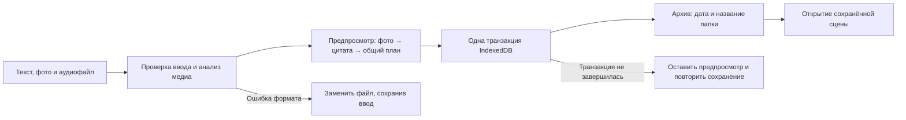

> **Исторический документ: рабочее название проекта «Между кадрами».** Актуальные концепция и план: [Office Hours](../designs/throughthelense-office-hours.md), [план разработки](../plans/throughthelense.md).

# «Между кадрами» — продуктовый и инженерный план

Архивная версия плана. Для реализации используйте [актуальный план ThroughTheLense](../plans/throughthelense.md), где в финале возвращается тот же ключевой снимок.

Genesis Hackathon · ArtTech · срок сдачи **22 ноября 2026, 23:59 по Астане**. Основа — выбранный командой [вариант B](mezhdu-kadrami.md) и бриф организаторов (не публикуется). Для объединённого CEO и Engineering Review принят рабочий режим Hold Scope. Все численные ограничения ниже, кроме требований брифа, — проектные значения и цели для первого прогона.

## CEO Review — что должно сработать

**Обещание.** Через время человек открывает свой день и вспоминает конкретную деталь, которую фото в галерее не передаёт. На ночном снимке видна пустая улица. Фраза «Мы впервые за неделю шли домой без спешки» и музыкальная пауза позволяют прочитать её как облегчение. Возвращение к этому моменту — центральный сценарий продукта и защиты.

**Чем отличается.** Apple Photos уже предлагает музыкальные фильмы, стили и регулировку темпа. Здесь смысловой центр — дословная деталь из личной записи. Аранжировка связывает её с фотографией и песней, а архив хранит результат. [Apple Photos — фильмы-воспоминания](https://support.apple.com/en-mide/guide/iphone/iph1a5832438/ios)

**Что доказать.** Начать защиту с повторного открытия дня. Затем показать создание и сравнение двух треков на одном тексте и фото. На трёх записях с разной атмосферой зритель должен узнать общую визуальную систему. Дать двум зрителям посмотреть главный день и попросить пересказать запомнившуюся деталь. Это проверка считываемости сцены. Долгосрочное возвращение к записям остаётся продуктовой гипотезой.

**Горизонт после хакатона.** Если люди начнут возвращаться к архиву, первым направлением для развития станет переносимость воспоминаний между устройствами. Хакатонная версия ограничена локальным архивом, одним веб-форматом и загрузкой файла. Аккаунты, облако, экспорт видео, музыкальные ссылки и озвучка за пределами выбранного объёма.

## Engineering Review — архитектура и границы

В проекте пока есть бриф и дизайн-док. Статическое веб-приложение на HTML, CSS и JavaScript использует браузерные API: Web Audio для анализа, элемент `audio` для воспроизведения и IndexedDB для архива. Исходные фото, текст и аудио остаются в браузере. Статический хостинг отдаёт приложение и публичные материалы трёх примеров.

Сравнили две схемы. **Выбрали браузерную сборку сцены**: пользователь видит интерактивный результат и может после перезагрузки открыть его из архива. Серверный рендер MP4 дал бы переносимый файл, но потребовал бы загрузки медиа, фоновой обработки и работы с экспортом. Для демонстрации браузерной сцены это лишние зависимости.

| Предлагаемый модуль | Что ему принадлежит |
|---|---|
| `index.html`, `styles.css` | Архив, форма дня и экран сцены. Одна сетка, общая типографика и расположение даты. |
| `app.mjs` | Навигация, состояние формы, текущая версия предпросмотра, управление плеером и доступные сообщения об ошибках. |
| `scene.mjs` | Подбор названия и цитаты, палитра, анализ аудио, расчёт и валидация трёх моментов сцены. Чистый расчёт принимает готовые признаки. |
| `journal.mjs` | Открытие базы, атомарное сохранение, список метаданных и загрузка одной записи. |
| `scene.test.mjs`, `README.md` | Детерминированные тесты правил, инструкция локального запуска и чек-лист реального браузера. |

### Данные и поток

Один день — одна именованная папка **в интерфейсе архива**. В IndexedDB v1 хранилище `entries` с индексом по дате отдаёт только метаданные `id, dayDate, title, coverThumbnail`. Хранилище `content` с тем же ключом содержит исходный текст, цитату, фото, аудио и `scene: {version, palette, quoteAtSec, revealAtSec, endAtSec, openingPhoto, closingPhoto}`. Дата хранится как локальная календарная дата в формате `YYYY-MM-DD`. Для доступа к файлам отдельного дня открываем только его запись. Ключ генерируется один раз на черновик. Обе части записываются в одной транзакции, подтверждение появляется после события `complete`. На время записи блокируются повторное сохранение и изменение текущих полей. При отказе черновик остаётся в памяти. Открытие использует сохранённый снимок сцены, поэтому будущая смена правил не меняет старый день. [Стандарт IndexedDB](https://w3c.github.io/IndexedDB/)



### Правила воспоминания

1. **Текст.** Поддержать русский и казахский текст без словаря эмоций. Из слов записи предложить заголовок из 3–7 слов. Для короткого текста подставить нейтральное начало «Мой день» и слово из записи. Выбрать короткое дословное предложение или его фрагмент. Автор может поправить название и выбрать другую дословную фразу в предпросмотре. Полный текст доступен и без звука.
2. **Фото.** Принимать 1–5 JPEG, PNG или WebP, до 8 MiB и ориентир до 24 мегапикселей на файл. Для анализа использовать первое фото и уменьшенную выборку пикселей. Для финала взять следующее доступное фото или показать общий план первого. Фон строится из сдержанного оттенка кадра, цвет текста выбирается по контрасту.
3. **Музыка.** Принимать MP3 или WAV, до 12 MiB и 60 секунд. Сначала проверить длительность через метаданные плеера, затем декодировать файл целиком и анализировать только начало сцены. Окна порядка 100 мс дают огибающую громкости. В двух диапазонах времени выбрать заметный подъём для цитаты и раскрытия кадра. На ровном треке использовать базовые точки около одной и двух третей сцены. Для короткого трека пропорционально укоротить сцену; нижний порог — 3 секунды. Длительность сцены ограничить 12 секундами; длинная цитата остаётся доступной вне анимации. Время в секундах, порядок инвариантен: `0 < quoteAtSec < revealAtSec < endAtSec`. [Web Audio API](https://webaudio.github.io/web-audio-api/#dom-baseaudiocontext-decodeaudiodata)
4. **Воспроизведение.** Старт по кнопке. Момент сцены вычисляется от `audio.currentTime`, поэтому пауза и возврат во вкладку синхронизируют экран со звуком. При достижении конца сцены поставить аудио на паузу и оставить последний кадр. Повтор возвращает время к нулю. При сниженной анимации кадры переключаются без движения. [HTML — медиаэлементы](https://html.spec.whatwg.org/multipage/media.html#dom-media-currenttime-dev)

```text
Архив → Форма → Расчёт → Предпросмотр → Сохранение → Архив → Сохранённый день
           ↑        │         ↑             │
           └─ сбой ─┘         └── сбой ──────┘

Сцена: Готова → Кадр → Цитата → Раскрытие → Завершена
                    ↕ пауза на любом этапе    │
                    └──── повтор с начала ────┘
```

### Ошибки, гонки и восстановление

| Путь | Сбой и реакция | Проверка |
|---|---|---|
| Форма → предпросмотр | Невалидный или тяжёлый файл, ошибка декодирования. Показать ошибку у поля и оставить текст и другие файлы. | Повреждённое фото, неподдерживаемый тип, слишком длинное аудио и валидная замена. |
| Повторный выбор трека | Старый анализ завершился после нового. Версия черновика проверяется после каждого асинхронного этапа перед обновлением экрана; пока идёт расчёт, нельзя сохранить устаревшую сцену. | Приостановить расчёт A, завершить B, отпустить A и убедиться, что сцена и сохранённые данные относятся к B. |
| Предпросмотр → запись | Двойное нажатие сохраняет один ID. При прерванной транзакции нет папки без файлов. Предпросмотр остаётся доступным. | Повторный клик, искусственное прерывание транзакции между двумя записями, поведение при отказе IndexedDB. |
| Архив → сцена | Пустой архив ведёт в форму. Недоступная запись показывает ошибку и кнопку возврата. Медиа загружаются только для открытого дня. | Чистый профиль, два дня с одной датой, переход по старому ID. |
| Плеер | Ошибка `play()` оставляет доступной кнопку повтора и статический текст. При уходе со страницы плеер останавливается и временные URL освобождаются. | Старт, пауза, повтор, конец, уход в архив и повторное открытие. |
| Хостинг | Данным нужен тот же адрес сайта и браузерный профиль. Смена адреса, очистка данных и пределы хранения могут лишить доступа. Подсказка у архива объясняет локальное хранение. | В сохранённом профиле день переживает перезагрузку. На новом профиле открываются публичные примеры; личный архив пуст. [Правила хранения браузеров](https://developer.mozilla.org/en-US/docs/Web/API/Storage_API/Storage_quotas_and_eviction_criteria) |

**Производительность.** Декодировать изображения по одному, освобождать временные ресурсы, хранить рассчитанные параметры и миниатюру. Список папок не декодирует песни и не читает исходные фото. При вводе максимального поддерживаемого набора замерить время до предпросмотра и открытия архива на ноутбуке и телефоне. Цель для типового дня — предпросмотр до 3 секунд на устройстве защиты; это ориентир для замера. Для диагностики записывать этап, длительность и код ошибки без пользовательского текста, имён файлов и медиа.

**Интерфейс.** Одна основная кнопка на экран, ошибки рядом с полями, текст читается без звука. Проверить клавиатуру, видимый фокус, контраст, режим снижения анимации и узкий экран. При пересоздании сцены показывать понятный статус и держать предыдущий результат до окончания расчёта.

**Граница личных данных.** Пользовательский текст подставляется как текст DOM, личные файлы открываются из локальных Blob URL. Публичные примеры поставляются отдельным набором материалов. Новый посетитель может открыть их и создать собственный день с пустым личным архивом.

## Тесты и порядок разработки

| Этап | Владелец | Проверяемый результат |
|---|---|---|
| **T1 — общий контракт** | Оба, первым шагом | Выбрать демонстрационный день, согласовать поля `scene` и `entry`, признаки источников и критерий заметного музыкального перехода. |
| **T2 — форма и архив** | Участник 1 после T1 | Создать запись с тестовой сценой, сохранить в реальную IndexedDB, перезагрузить и открыть её. Проверить пустой архив, повторный клик и прерванную запись. |
| **T3 — сцена и музыка** | Участник 2 параллельно T2 | На готовых материалах показать три момента, паузу и повтор. Модульные тесты: короткая запись, дословность цитаты, один снимок, тишина, два разных акцента и порядок времён. |
| **T4 — интеграция** | Оба после T2 и T3 | Пройти сквозной путь в Chromium и проверить его на телефоне в Safari. Сменить только трек, увидеть иной переход, затем открыть оригинал после перезагрузки и сравнить сохранённые параметры. Проверить ошибки из таблицы. |
| **T5 — сдача** | Оба после T4 | Открыть публичный HTTPS-адрес в чистом профиле, проверить три примера и новый день. Записать ролик до трёх минут; приложить три результата, страницу описания, художественные приёмы, исходники и список инструментов. |

**Порядок по дням.** 19 ноября — T1 и старт двух параллельных частей. 20 ноября — соединение на одном дне и проверка хранения. 21 ноября — три дня, проверка на телефоне и запись чернового ролика. 22 ноября — исправления, финальный прогон и загрузка заявки с запасом до дедлайна. Это календарная разбивка, пока не оценены фактические рабочие часы.

**Проверки перед релизом.** Для чистых правил запускаем `node --test scene.test.mjs`. В браузере подаём два тестовых трека с акцентами в разных местах и ожидаем сдвиг одного из переходов хотя бы на 0,75 секунды. Это рабочий порог для демо. Он не заменяет просмотр сторонним зрителем. Для ручного прогона можно поднять сайт из корня через `python3 -m http.server 8000`.

**Развёртывание.** Статический HTTPS-хостинг с постоянным адресом, один релиз для сдачи. Последовательность — локальный прогон, публикация, проверка публичного адреса, выпуск заявки. Сохраняем предыдущую рабочую сборку. При сбое возвращаем её на том же адресе и открываем ранее сохранённый день. До сдачи оставляем схему v1. Обратимый деплой зависит от сохранения адреса и совместимости схемы. Демонстрационные материалы используют собственные или свободно лицензированные файлы.

## Решения и допущения

| Решение | Основание |
|---|---|
| Вариант B | Явный выбор команды в Office Hours. |
| Hold Scope | Рабочее допущение ревью из срока и выбранного дизайна. |
| Именованная папка дня в архиве | Интерпретация требований брифа. В браузере это одна логическая папка с исходниками и готовой сценой. |
| Браузер без сервера и жёсткая проверка на двух движках | Рабочий способ уложиться в срок. Браузерные сбои и формат файлов проверяются на реальных устройствах. |

## GSTACK REVIEW REPORT

| Review | Trigger | Runs | Status | Findings |
|---|---|---:|---|---|
| CEO Review | `/plan-ceo-review` | 1 | План составлен | Уникальность строится на авторской детали. В демо нужно доказать возврат из архива и заметность музыки. |
| Eng Review | `/plan-eng-review` | 1 | План составлен | Определены границы модулей, модель данных, гонки, ошибки и тесты. Браузерные сценарии ещё предстоит реализовать и проверить. |
| Outside Review | Claude Code | 0 | Недоступен | В текущем окружении отсутствует Claude Code CLI. |

**OUTSIDE COVERAGE:** внешний проход не выполнен. **VERDICT:** готов план для команды; соответствие прототипа критериям проверяется на T4–T5.

NO UNRESOLVED DECISIONS
