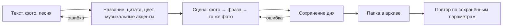

# ThroughTheLense — план до сдачи

Genesis Hackathon · ArtTech · команда из двух участников. Дедлайн **22 ноября 2026, 23:59 по Астане**. Бриф организаторов (не публикуется) · [Концепция и исследование](../archive/mezhdu-kadrami-concept.md)

**Результат.** Публично доступный веб-прототип, в котором можно создать воспоминание из текста, фото и песни, сохранить его в папку дня и заново открыть после перезагрузки. На защите жюри видит три разных дня и момент, когда личная фраза меняет восприятие того же снимка.

**Статус демо.** Локальная версия реализована. Команда выбрала локальный показ на этом этапе. [Запуск, примеры и проверка](../../README.md). Ниже сохранён исходный план хакатона.

## 1. Границы версии

| Включаем в версию для хакатона | Считаем готовым, когда |
|---|---|
| Ввод текста, 1–5 фото и одного музыкального файла | Достаточно одного снимка, короткой записи и одного подходящего трека. Выбранные материалы можно заменить до сохранения. |
| Автоматическое оформление | Система предлагает название из 3–7 слов и дословную фразу из записи. Автор может изменить название и выбрать другую фразу. Цвет оформления приходит из фото, ритм — из песни. |
| Один формат — короткая интерактивная сцена | По нажатию звучит музыка. Ключевой снимок, личная деталь и **тот же снимок** идут в этом порядке. Финал даёт время дочитать фразу и повторить сцену. |
| Папка дня и архив | В папке под предложенным названием лежат полный текст, снимки, трек и сохранённая сцена. Перезагрузка сохраняет день, два дня с одной датой открываются по отдельности. |
| Примеры для жюри | На чистом профиле можно открыть три публичных примера с разным настроением или создать свой день. Если основные проверки пройдены и есть время, доводим подборку до пяти для проверки визуальной цельности. |

Один источник музыки — загруженный файл. Аккаунты, синхронизацию, музыкальные сервисы, озвучку, экспорт видео и модели генерации оставляем за пределами хакатонной версии. Бриф допускает файл или ссылку, а озвучку описывает как дополнительную. Бриф ArtTech, стр. 3 (не публикуется)

## 2. Вид и поведение

| Экран | Что первым видит человек | Что может сделать |
|---|---|---|
| **Архив** | Название проекта, папки по датам, крупные миниатюры и названия дней | «Новый день», открыть свою папку или отдельный публичный пример |
| **Новый день** | Дата, поле «Как прошёл день?», выбор фото и песни | Заполнить материалы и нажать «Посмотреть». Подсказка «Что осталось за кадром?» появляется рядом с текстом. |
| **Предпросмотр** | Ключевое фото и кнопка «Воспроизвести» | Прослушать сцену, изменить название или выбрать другую цитату, вернуться к материалам, нажать «Сохранить день» |
| **Сохранённый день** | Дата, ключевой кадр и управление воспроизведением | Посмотреть сцену, развернуть полный текст и исходные материалы, вернуться в архив |

**Раскадровка.** В первом моменте показываем дату и узнаваемый кадр. В момент раскрытия появляется короткая дословная фраза. Затем возвращается **тот же файл фотографии**. Кадрирование может мягко измениться, если снимок остаётся узнаваемым. Цитата остаётся доступной после финала. Полное название видно в архиве и перед запуском сцены, а в самой сцене первый кадр не перекрываем надписью, которая заранее выдаёт её главную деталь.

**Визуальная система.** Тёплый бумажный фон `#F6F2EA`, тёмные чернила `#252721`, приглушённый зелёный для основного действия `#52634E`. Фотография даёт оттенок поля вокруг кадра. Цитата и кнопки используют предсказуемый контраст на однотонном фоне. Для цитаты — Georgia с запасным serif, для формы — системный шрифт. Фиксируем расположение даты, ширину текстовой колонки и свободное пространство вокруг фото. На телефоне — одна колонка и крупная кнопка под кадром. На широком экране — кадр и заметка рядом при просмотре исходников. Проверяем казахские и русские символы, ширину 360 px, клавиатуру, фокус, управление звуком и режим уменьшенного движения. Ориентир для обычного текста — контраст 4,5:1. [W3C — минимальный контраст](https://www.w3.org/WAI/WCAG22/Understanding/contrast-minimum.html)

**Состояния.** У пустого архива есть «Новый день» и «Посмотреть пример». Во время анализа показываем «Готовим воспоминание». Ошибка медиа отображается рядом с соответствующим полем, черновик сохраняется на экране. После успешного сохранения открывается папка и появляется подтверждение. Если запись недоступна, экран предлагает вернуться в архив. Если звук не запустился, остаются повтор и доступ к тексту.

## 3. Как это сделать

**Стек.** Статический HTML, CSS и JavaScript с модулями. Web Audio для анализа файла, элемент `audio` для воспроизведения, IndexedDB для личного архива. На хостинг попадают приложение и подготовленные публичные примеры. Личный ввод остаётся в браузере. Папка дня — представление записи в интерфейсе. Личный архив доступен на том же адресе сайта, в том же браузерном профиле. Очистка данных может удалить записи. [Стандарт IndexedDB](https://w3c.github.io/IndexedDB/) · [Правила хранения браузеров](https://developer.mozilla.org/en-US/docs/Web/API/Storage_API/Storage_quotas_and_eviction_criteria)

### Контракт между двумя участниками

Подготовить один общий пример данных перед разделением работы. В макете сцены можно подставить его вручную до подключения реального анализа.

| Данные | Поля и правило |
|---|---|
| `entry` | `id`, `dayDate` в формате `YYYY-MM-DD`, `title`, `text`, `photoFiles`, `audioFile`, `scene`. Один ID на черновик. |
| `scene` | `version: 1`, `coverPhotoIndex`, `quote`, `palette`, `quoteAtSec`, `returnAtSec`, `endAtSec`. Для первого и финального кадра используется `coverPhotoIndex`. Времена строго возрастают. |
| `entries` в IndexedDB | Метаданные для архива: ID, дата, название и миниатюра. Сортировка по дате, при совпадении — по ID. |
| `content` в IndexedDB | Полный текст, медиа и сохранённый снимок сцены по тому же ID. Записывается атомарно вместе с метаданными. Успех только после завершения транзакции. |

Предлагаемая структура: `index.html` и `styles.css` — экранная разметка и стиль, `app.mjs` — форма, навигация и плеер, `scene.mjs` — правила композиции и анализа, `journal.mjs` — запись, список и открытие дней, `scene.test.mjs` — тесты чистых правил, `demo/` — публичные примеры. При работе параллельно один участник владеет `app.mjs`; второй ведёт сцены и стили. Связку плеера с экраном сводят вместе по общему контракту.

### Правила работы сцены

1. **Текст.** Разбить запись по предложениям и переносам строк. Для названия взять первые 3–7 слов первого подходящего смыслового фрагмента. Если слов меньше трёх, добавить нейтральное начало на языке интерфейса и использовать слова записи. Отклонить ввод без слов. Для цитаты предложить короткое предложение, отдавая приоритет конкретной детали вроде «впервые», «услышали» или «пахло». Когда подходящего предложения нет, выбрать начальный фрагмент до границы слова. Сохранять цитату как дословный фрагмент, исходный текст целиком и правку названия отдельно. Автор может выбрать другой дословный фрагмент.
2. **Фотографии.** На первую версию принять JPEG, PNG и WebP. Предлагаемые лимиты — до 8 MiB на файл и до пяти снимков. Первое фото становится ключевым. Уменьшить его для анализа, усреднить цвет непрозрачных пикселей и смешать его с бумажным фоном. Дополнительные фотографии, если есть, лежат в папке дня. Ключевой кадр для первого и второго взгляда один и тот же.
3. **Музыка.** Принять MP3 или WAV. Предлагаемые границы — 3–60 секунд и до 12 MiB. Для сцены взять до 12 секунд. Измерить энергию коротких окон порядка 100 мс, нормализовать по максимальной энергии и найти по одному отчётливому подъёму или спаду. Начальные диапазоны для событий — 20–40% и 62–82% длительности. В каждом диапазоне выбрать наибольшее изменение между соседними сглаженными окнами. Если изменение слабое, поставить событие на 33% или 72% соответственно. На коротких файлах времена пропорционально сжимаются. Если файл нельзя открыть, предложить замену. Браузер декодирует полный файл, поэтому размер и длительность ограничиваем до начала анализа. [Web Audio API](https://webaudio.github.io/web-audio-api/#dom-baseaudiocontext-decodeaudiodata)
4. **Плеер.** Запускать музыку по нажатию. Стадию сцены определять по времени `audio.currentTime`, а не по отдельным таймерам. На паузе изображение останавливается, при повторе всё возвращается к началу, после конца остаётся финал с цитатой. При выходе звук прекращается. [HTML Standard — медиаэлементы](https://html.spec.whatwg.org/multipage/media.html#dom-media-currenttime-dev)

### Что ломается и как это пережить

| Ситуация | Поведение | Как проверить |
|---|---|---|
| Старый анализ заканчивается после выбора новой песни | Возвращённый результат применяется только к последней версии черновика. Пока музыка пересчитывается, сохранение блокируется. | Задержать анализ A, выбрать B, затем завершить A. В предпросмотре и сохранённом дне остаётся B. |
| Сохранение нажали дважды или транзакция оборвалась | Один ID и одна активная запись. При ошибке остаётся черновик; неполная папка в архиве не появляется. | Двойной клик и прерывание записи между двумя хранилищами. |
| Ввод не читается или заполнен частично | Указать поле, сохранить остальной ввод и дать заменить один файл. | Пустой текст, неподдерживаемое фото, повреждённый трек, валидная замена. |
| Песня тихая или файл короткий | Сцена идёт в базовом ритме и всё равно заканчивается читаемым финалом. | Проверить тишину, равномерный трек и короткий допустимый файл. |
| Сайт открыт на другом устройстве или в новом профиле | Личный архив начинается пустым. Публичные примеры доступны отдельно. | Открыть опубликованный сайт в чистом профиле. |

## 4. Порядок работы на двоих

| Этап | Участник 1 — форма и хранение | Участник 2 — сцена и оформление | Общий критерий готовности |
|---|---|---|---|
| **T1 · 19 ноября** | Создаёт простой путь от формы к предпросмотру | Собирает раскадровку на реальных материалах и выбирает характер оформления | Оба согласовали один показательный день, общий формат данных и две разные песни для сравнения. |
| **T2 · 19–20 ноября** | Делает валидацию формы, IndexedDB и архив. Проверяет сохранение с тестовой сценой. | Делает воспроизведение, повтор кадра, цитату и расчёт переходов от музыки. | К концу 20 ноября новый день можно создать через обычный интерфейс, сохранить, перезагрузить страницу и открыть снова. |
| **T3 · 21 ноября** | Проверяет ошибки, чистый профиль и публикацию | Доводит три разных дня, правит темп, читабельность текста и мобильную сцену | Три дня открываются на опубликованном адресе. Смена только трека заметна, а название, фото и архив работают. |
| **T4 · 22 ноября** | Финальная проверка ссылки и комплектация заявки | Запись и монтаж демонстрации, примеры и описание визуальной системы | Внутренняя цель — собрать заявку к 20:00 по Астане и оставить запас до 23:59. |

Начните одним коротким совместным отрезком: взять реальную фотографию, выписать одну дословную фразу, подобрать разрешённые фрагменты двух разных треков и наметить на бумаге три момента сцены. Затем один участник строит полный путь до архива с временными параметрами, второй параллельно доводит ту же сцену с реальным музыкальным ритмом. Соединяйте части сразу на одном дне.

Если 20 ноября сквозной путь ещё не работает, сначала доведите его на одном фото. На 21 ноября остаются ещё два дня и проверка. При нехватке времени сокращайте оформление и число дополнительных примеров, сохраняя реальный вклад музыки, повтор ключевого кадра и повторное открытие.

## 5. Проверка, публикация и защита

**Проверки до записи ролика**

- Модульные тесты: заголовок из 3–7 слов, дословность фразы, строгий порядок времён, стабильный повтор кадра и отличие двух тестовых треков. После появления тестов запускать `node --test scene.test.mjs`.
- Сквозная проверка: с нуля в обычном Chrome создать день, сохранить, обновить страницу, открыть папку, проиграть сцену. Повторить основной путь в Safari на доступном телефоне или явно указать, на каких браузерах он проверен.
- Демонстрация влияния: на одном тексте и фото перезапустить предпросмотр со вторым треком. Разница должна читаться на глаз. Пробный измеримый ориентир — сдвиг хотя бы одного перехода на 0,75 секунды на выбранной паре треков. Затем вернуть оригинал.
- Проверка восприятия: показать основной день двум людям без предварительного объяснения и спросить, какую деталь они запомнили. Если оба описывают лишь оформление, подобрать более точную фразу или перестроить паузу.
- Перед сдачей открыть публичный HTTPS-адрес в чистом профиле без учётной записи, проверить открытие примеров и создание нового дня. Резерв для защиты — заранее записанный ролик на случай проблем со связью.

Для локального прогона готового прототипа из корня можно использовать `python3 -m http.server 8000 --bind 127.0.0.1`. Для публикации нужен статический HTTPS-хостинг с постоянным адресом. Если последняя публикация ломает просмотр, вернуть предыдущую рабочую сборку на тот же адрес и открыть уже сохранённый день. Базу до сдачи держать в версии 1.

**Ролик до 3:00**

| Время | Что показать |
|---|---|
| 0:00–0:30 | Открыть главный день из архива и целиком показать первый взгляд, фразу и второй взгляд. |
| 0:30–1:20 | Показать, из чего получилась сцена: текст, фото, песня, предложенное название и сохранение. |
| 1:20–1:55 | Сменить только песню в предпросмотре. Показать различие в моменте раскрытия. |
| 1:55–2:30 | Открыть ещё два дня и показать единый язык архива. |
| 2:30–2:50 | Назвать художественные приёмы и показать адрес прототипа. |

**Комплект сдачи.** Рабочая ссылка или инструкция запуска, ролик до 3 минут, 3–7 готовых результатов с названиями папок, описание идеи и правил до одной страницы, список художественных приёмов, код или подтверждение вклада и список использованных инструментов. В публичных примерах используем собственные или разрешённые фотографии, тексты и музыку. Бриф ArtTech, стр. 4–5 (не публикуется)

## 6. Какие навыки использовать

| Навык | Когда нужен | Что получить |
|---|---|---|
| `/context-save` | После фиксации решения и крупных изменений | Сохранённое название, концепция и актуальные ссылки для продолжения работы. |
| `/plan-design-review` | Для раскадровки и UI перед разработкой | Иерархию экранов, единый визуальный язык, сценарии ошибок и проверку телефона. Эти решения сформулированы в разделе 2. |
| `/plan-eng-review` | Для проверки контракта между двумя участниками | Поток данных, границы модулей, ошибки, тесты и порядок интеграции. Эти решения сформулированы в разделах 3–5. |
| `/qa-only` | Когда опубликован работающий прототип | Прогон обычного сценария, мобильной версии и публичной ссылки. Выполняется после реализации. |

Продуктовый выбор уже сделан в Office Hours и CEO Review, поэтому текущий план использует их результаты. Для работы на хакатоне достаточно этих точек проверки.

## GSTACK REVIEW REPORT

| Review | Trigger | Runs | Status | Findings |
|---|---|---:|---|---|
| Eng Review | `/plan-eng-review` | 1 | План проработан | Зафиксированы один ключевой кадр, атомарная запись, защита от устаревшего анализа и проверки. |
| Design Review | `/plan-design-review` | 1 | План проработан | Раскадровка, состояния и визуальная система описаны текстом. Проверка по живому интерфейсу предстоит. |

**VERDICT:** план готов для начала реализации. Имена и материалы трёх дней выбирает команда на T1–T3. Сроки внутри этапов, лимиты файлов и пороги переходов — стартовые значения до проверки на устройстве защиты.

NO UNRESOLVED DECISIONS
